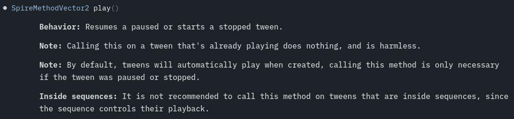
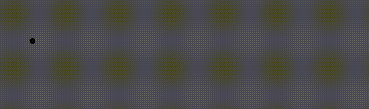
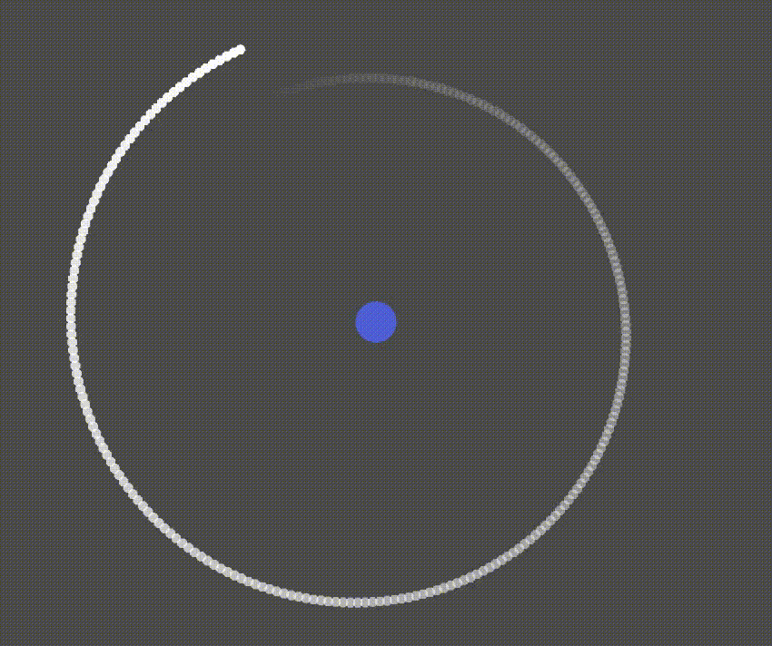
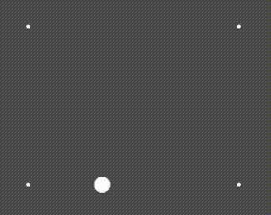
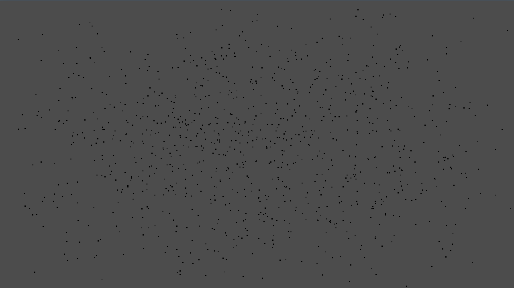
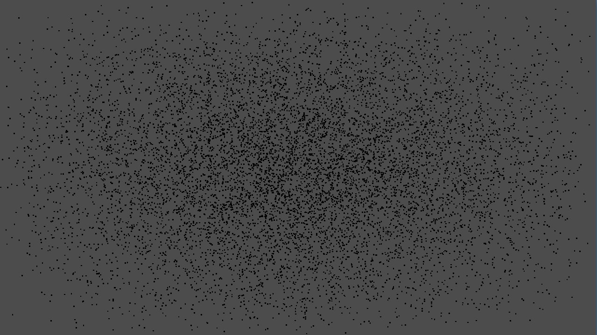
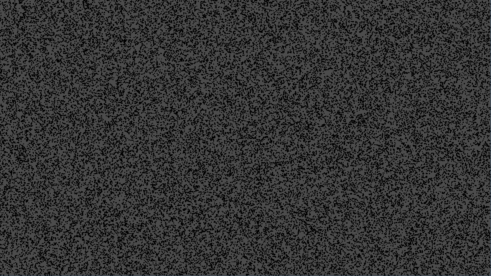
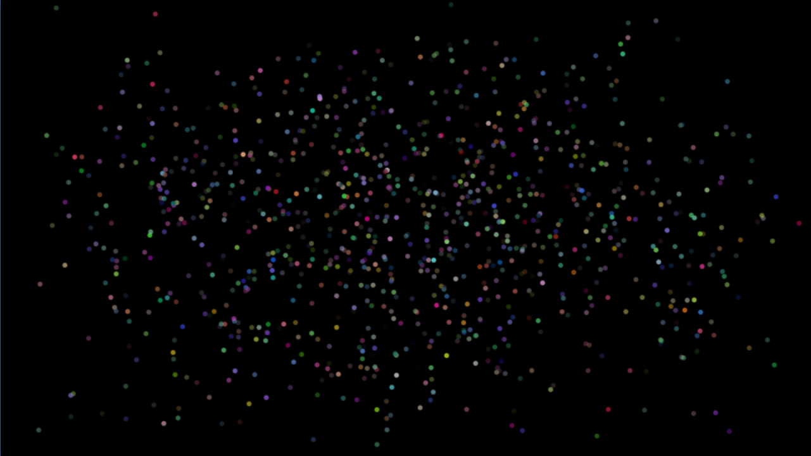
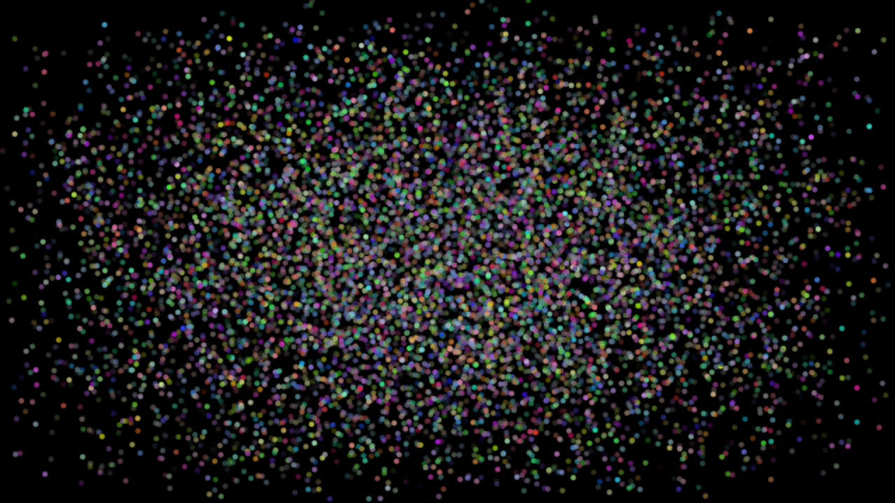

# Showcase


*This gif was recorded from the example scene [example_powerup.tscn](spire_tween_gdscript/examples/powerup/example_powerup.tscn)*

*Credit for the character sprites goes to [JumpButton](https://jumpbutton.itch.io/girlknightasset).*

---

Here's the code used to move the energy spheres (1st phase of the gif):

```gdscript
var ball: Sprite2D = balls[i]

# Rotate the ball around the character in a spiral pattern.
# `log_growth` is only read when mode is `SPIRAL_LOGARITHMIC`; pass `Vector2.ZERO` for the other modes.
DoNode2D.spiral(ball, center, from_angle, to_angle, scale, duration, rotation, shear, Spire.SPIRAL_FERMAT, Vector2.ZERO)

# Fade-in the ball, achieved my lerping its "modulate" property from 0.0 to 0.8.
DoCanvasItem.color_a(ball, 0.8, duration).from(0.0)

# Steadily scale the ball towards 0.25, starting at 0.
DoNode2D.scale(ball, Vector2(0.25, 0.25), duration).from(Vector2.ZERO)
```

And here's the code used to make the balls quickly expand and fade away (2nd phase of the gif):

```gdscript
var ball: Sprite2D = balls[i]

DoCanvasItem.color(ball, Color(1, 1, 1, 0), 2.0).set_ease(Spire.EASE_OUT_EXPO)
DoNode2D.scale(ball, Vector2.ONE * 3, 2.0).set_ease(Spire.EASE_OUT_EXPO)
```

---

SpireTween is a batteries-included tweening library for Godot 4.x, inspired on the UX of the popular Unity library [DoTween](https://dotween.demigiant.com/).

These are the priorities of SpireTween:

- Ergonomics without compromising performance (see section [Benchmarks](#benchmarks)).
- Type safety, taking advantage of GDScript's type system to catch errors at compile time rather than runtime.
- "No surprises": Spire's public API is thoroughly (and proudly!) documented, with method descriptions mentioning possible side effects and quirks. I also wrote plenty of integration tests to make
  sure the behavior matches what's written in the docs (see folder [tests](spire_tween_gdscript/examples/tests)).

  Here's an example: The method `play` that all tweens have (screenshot taken inside the Godot Editor):
  
- At minimum, feature parity with Godot's built-in tweening system (after all, why would you want a downgrade?). SpireTween also provides more features, such as: speed-based tweens, more loop modes,
  etc.

# Summary

- [Installation](#installation)
- [Platform Support](#platform-support)
- [Running integration tests](#running-integration-tests)
- [Configuration](#configuration)
- [Cheat Sheets](#cheat-sheets-built-in-tween---spiretween)
- [Examples](#examples)
- [Benchmarks](#benchmarks)
- [Feature Requests](#feature-requests)
- [License](#license)

# Installation

Extract the `spire_tween` directory into your project's `addons` directory. The resulting layout should include `res://addons/spire_tween/spire_tween.gdextension` and its `lib` directory. Open or reopen the project in Godot so it discovers the extension.

You can acquire a copy of SpireTween through 3 means:

- Purchase it at [Itch.io](http://www.itch.io/placeholder_link), it includes binaries for most mainstream platforms (see section [Platform Support](#platform-support)).
- A demo version is available in the [releases](https://github.com/Houtamelo/spire_tween_gdscript/releases) page of this repository. The only "limitation" of the demo is that it only includes binaries
  for Windows and Linux platforms. Binaries for additional platforms can be acquired by purchasing the plugin or compiling it yourself.
- Compile from source (see [Building from source](#building-from-source)).

When exporting, Godot will automatically include the necessary binary for the chosen target platform.

The GDExtension registers `Spire`, `Do{Class}`, `SpireSequence`, and the other classes automatically. No Project Settings → Plugins switch or autoload setup is required; the tween manager initializes on first use.

SpireTween requires `Engine.get_main_loop()` to return a `SceneTree` with an available root before the manager's first use. Creating tweens from a scene Node's `_ready()` satisfies this requirement. In a custom `SceneTree` main-loop script, defer tween creation until the main loop is installed; its constructor and member initializers run too early. An unsupported main-loop type or premature first use prints an initialization error. The manager does not retry initialization, so correct the startup call and restart the application if this error occurs.

Attach this script to a Node and run the scene to check installation:

```gdscript
extends Node

func _ready() -> void:
    Spire.do_delayed_call(func(): print("SpireTween loaded"), 0.1)
```

## Building from source

SpireTween is written in Rust against [godot-rust](https://github.com/godot-rust/gdext) and requires **nightly** Rust. `rust-toolchain.toml` pins a dated toolchain, and the root `Cargo.lock` records the release dependency snapshot. The [release workflow](release/README.md) builds Windows, Linux and universal macOS libraries with the explicit Godot 4.4 API feature; ordinary development builds retain their default API selection.

The crate uses these unstable features:

```rust
#![feature(type_changing_struct_update)]
#![feature(unboxed_closures)]
#![feature(arbitrary_self_types)]
#![feature(stmt_expr_attributes)]
```

Build the addon binary for your host with the per-platform scripts in [`build_scripts/`](build_scripts):

```bash
# Linux x86_64
./build_scripts/build_linux.sh
# Windows native build: use Bash in an MSVC developer environment
./build_scripts/build_windows_64.sh
# Windows cross-compile from Linux: requires an xwin SDK and LLVM tools
XWIN_DIR="/path/to/xwin" ./build_scripts/build_windows_64.sh
# macOS: requires a Mac with Xcode command line tools
./build_scripts/build_macos.sh
# Android: requires cargo-ndk and a version-specific NDK installation
ANDROID_NDK_HOME="/path/to/android-ndk/version" ./build_scripts/build_android.sh
# WebAssembly: activate an Emscripten SDK so emcc is on PATH
./build_scripts/build_wasm.sh
```

Desktop/Android scripts stage fresh release artifacts in `dist/staging/<platform>`, including provenance and checksums. Copy the staged `addon` directory to your project's `addons/spire_tween` directory for local use. Existing staging output is rejected; choose a fresh path with `SPIRE_RELEASE_OUT`. The experimental Web script retains its development output under `spire_tween_gdscript/addons/spire_tween/lib/` and is excluded from the desktop release workflow. See [release verification and packaging](release/README.md).

To build the host addon library directly, enable both its extension entry point and GDScript bridge:

```bash
cargo build -p spire_tween --release --features include_gdext_lib,include_gdscript_bridge
```

The library is written to `target/release`; the platform scripts also place artifacts into the addon directory. A plain `cargo build --release` builds the default library member without enabling those addon features.

## Running integration tests

From the repository root, request every GDScript test without reading or writing cached results:

```bash
godot --headless --path spire_tween_gdscript res://examples/tests/test_runner.tscn -- --all-tests --no-cache
```

The editor's run-mode setting remains available for selective runs. The aggregate runners exit nonzero on failed tests or timeouts. GDScript tests must use `TestBase.assert_true`, `assert_eq`, `assert_ne`, `assert_le`, `assert_ge`, or `_assert_within_tolerance`: these record failures even when a test body returns `true`. Godot's built-in `assert` only aborts its current function and must not be used in ordinary assertion helpers. Native cases report named setup and async failures; use `assert_finished_timing` or the `assert_upon_*` helpers for assertions invoked through signals or tween callbacks.

Both runners accept `--test=test_name`, `--test-timeout=seconds`, and `--suite-timeout=seconds` after `--`. Deadlines use elapsed wall time and default to 60 seconds per test and 900 seconds for the suite; the suite watchdog continues while the tree is paused or time-scaled. An unmatched test name or invalid timeout exits nonzero.

The GDScript cache includes the selected addon binary and engine executable SHA-256, engine version, shared test scripts/scenes, project/extension configuration, and clock settings. `--no-cache` bypasses both cache reads and writes. Old cache formats and changed identities are discarded.

Run the full native suite with a real clock, because its `ignore_time_scale` test compares engine time with wall time:

```sh
godot --headless --path spire_tween_rust --max-fps 120 res://test_runner.tscn
```

To verify the runners themselves on Linux x86_64, build both profiles of the native test extension
and standalone addon, then run the real-engine failure/cache regression checks:

```sh
cargo build -p spire_tween_rust --locked --features spire_tween/include_gdscript_bridge
cargo build -p spire_tween_rust --release --locked --features spire_tween/include_gdscript_bridge
cargo build -p spire_tween --locked --features include_gdext_lib,include_gdscript_bridge
cargo build -p spire_tween --release --locked --features include_gdext_lib,include_gdscript_bridge
python3 scripts/verify_test_runners.py --godot godot
```

The verifier copies the example projects' existing imported caches and fresh libraries
into temporary fixtures. It checks passing cases, deliberately failing cases, paused-tree
timeouts, and cache invalidation after changing actual source files and addon artifacts.

The sequence speed suite is included in the regular test catalog. To run its 121
parameter cases independently, use the focused runner, which exits nonzero on a
failed check or timeout:

```sh
godot --headless --path spire_tween_gdscript --script res://examples/tests/sequence_speed_runner.gd
```

The ellipse/circle regression suite is also in the regular catalog. Its focused
runner checks deterministic geometry and receiver cancellation, and exits nonzero
on a failed check or timeout:

```sh
godot --headless --path spire_tween_gdscript --script res://examples/tests/ellipsis_regressions_runner.gd
```

To check the runner's command-line configuration and cache handling directly:

```bash
godot --headless --path spire_tween_gdscript --script res://examples/tests/runner_cli_checks.gd -- --all-tests --no-cache
```

The native manager-bookkeeping suite observes actual node records and weak binding
entries through read-only counters gated by `integration-tests`. The native demo/test
crate enables that feature; standalone addon builds leave it disabled. Build the
native test extension and place its fresh library at the path selected by
[`spire_tween_rust/addons/spire_tween/spire_tween.gdextension`](spire_tween_rust/addons/spire_tween/spire_tween.gdextension), then run:

```sh
cargo build -p spire_tween_rust --locked --features spire_tween/include_gdscript_bridge
# Confirm the manifest resolves to the fresh build before running.
godot --headless --path spire_tween_rust --fixed-fps 120 res://examples/tests/bookkeeping_runner.tscn
```

The focused runner exits nonzero on failed assertions. It covers repeated deletion
batches, both processing loops, expired bindings on living nodes, retained handles,
node re-entry, and node duplication. The regular native runner also runs these
checks before its other suites. The passing runtime verification and remaining
editor execution caveat are recorded in
[the follow-up evidence](release_audit_evidence/bookkeeping_followup_2026_10_13/README.md).

The method-validity suites cover silent cancellation of invalid callables, manual
stepping, paused/playing forced completion, custom interpolation, and sequence
children, with successful completion and replay controls. After installing fresh
native and standalone addon libraries, run the focused suites:

```sh
godot --headless --path spire_tween_rust --fixed-fps 120 res://examples/tests/method_validity_runner.tscn
godot --headless --path spire_tween_gdscript --fixed-fps 120 res://examples/tests/method_validity_runner.tscn
```

Both runners exit nonzero on a failed check and are included in the regular test
catalogs. [Verification evidence](release_audit_evidence/method_validity_2026_10_13/README.md)
records the initial failing controls. The
[ownership follow-up](release_audit_evidence/callable_retention_2026_10_14/README.md)
verifies consumer-owned removal and retained stopped handles in debug/release.

# Platform Support

SpireTween is made with [Godot-Rust](https://github.com/godot-rust/gdext), a GdExtension that provides Rust bindings for Godot. It *should* be compatible with all platforms supported by Godot-Rust.

I simply don't have the hardware needed to test on all platforms, I'll be updating this table as users report their testing results.

Binaries for all platforms which I successfully compiled-to are included in the releases sold at Itch.io.

| Platform           | Compiled | Tested | Notes                                                               |
|--------------------|:--------:|:------:|---------------------------------------------------------------------|
| linux.x86_64       |    ✅    |   ✅   |                                                                     |
| windows.x86_64     |    ✅    |   ✅   |                                                                     |
| android.x86_64     |    ✅    |   ❌   |                                                                     |
| android.arm64      |    ✅    |   ❌   |                                                                     |
| android.x86        |    —     |   ❌   | Excluded from the release pipeline.                                 |
| web.wasm32         |    ❌    |   ❌   | There is a temporary issue, will be fixed soon(TM).                 |
| web.wasm32.threads |    ❌    |   ❌   | There is a temporary issue, will be fixed soon(TM).                 |
| macos.arm64/x86_64 |    ❌    |   ❌   | Universal framework build/test CI configured; first verified run pending. |
| ios                |    ❌    |   ❌   | Outside the initial release scope.                                  |

The current Linux x86_64 debug and release libraries require **GLIBC 2.34 or newer**, measured with `readelf --version-info`. An older Linux userspace has not been tested.

If a platform you're targeting is not listed here, please open an issue.

# Configuration

Currently, SpireTween supports a single global configuration option, which lets you define what is the default "Ease" type when creating tweens. You can set this option by calling
`SpireGlobalSettings.set_default_ease`:

```gdscript
func _ready():
    # Set the default easing to "In-Out Sine", which is Godot's built-in Tween's default easing.
    SpireGlobalSettings.set_default_ease(Spire.EASE_IN_OUT_SINE)
```

If not set, the default is `Spire.EASE_LINEAR`.

# Cheat Sheets: Built-in Tween -> SpireTween

## Cheat Sheet: Type analogies

*(From here on, the names in the table bellow may be used interchangeably.)*

| Godot Built-in  | SpireTween                                          |
|-----------------|-----------------------------------------------------|
| Tween           | SpireSequence                                       |
| PropertyTweener | SpireProperty{Type}                                 |
| MethodTweener   | SpireMethod{Type}                                   |
| CallbackTweener | SpireDelayedCall                                    |
| IntervalTweener | No type, use `SpireSequence.append_interval(float)` |
| SubtweenTweener | SpireSequence[note1](#note-subtweeners)             | 

<a name="note-subtweeners"></a>
Note 1: A `SpireSequence` is itself a `SpireTween`, so you can append sequences into others, recursively.

---

**Note:** In the tables below, the columns "Godot Class (es)" and "Spire Class (es)" indicate which classes support the feature.

## Cheat Sheet: Properties

Cheat sheet for reading/writing properties/configuration that are common to both systems:

| Property                                                                |                    Godot Class(es)                    |        Godot Read        |                     Godot Write                      |          Spire Class(es)           |        Spire Read        |                          Spire Write                          |
|-------------------------------------------------------------------------|:-----------------------------------------------------:|:------------------------:|:----------------------------------------------------:|:----------------------------------:|:------------------------:|:-------------------------------------------------------------:|
| Loops (total) ([note1](#note-loop-modes))                               |                         Tween                         |            ❌            |                    set_loops(int)                    |                All                 |       get_loops()        |                set_loops(int, Spire.LoopMode)                 |
| Loops Left                                                              |                         Tween                         |     get_loops_left()     |                          ❌                          |                All                 |     get_loops_left()     |                              ❌                               |
| Loops Completed                                                         |                          ❌                           |            ❌            |                          ❌                          |                All                 |   get_loops_finished()   |                              ❌                               |
| Loop Mode                                                               |                          ❌                           |            ❌            |                          ❌                          |                All                 |     get_loop_mode()      |                 set_loop_mode(Spire.LoopMode)                 |
| Run                                                                     |                         Tween                         |       is_running()       |                        play()                        |                All                 |       is_playing()       |                            play()                             |
| Pause                                                                   |                         Tween                         |      !is_running()       |                       pause()                        |                All                 |       is_paused()        |                            pause()                            |
| Stop                                                                    |                         Tween                         |            ❌            |                        stop()                        |                All                 |       is_stopped()       |                            stop()                             |
| Validity ([note2](#note-is-valid))<br/>(is it "ticked" on each update?) |                         Tween                         |        is_valid()        |                        kill()                        |                All                 |     is_registered()      |                  register()<br/>unregister()                  |
| Delay                                                                   |           PropertyTweener<br/>MethodTweener           |            ❌            |                   set_delay(float)                   |                All                 |       get_delay()        |                       set_delay(float)                        |
| Elapsed Time (total)                                                    |                         Tween                         | get_total_elapsed_time() |                          ❌                          |                All                 | get_total_elapsed_time() |                              ❌                               |
| Animation position (current loop's elapsed time, after any delays)      |                         Tween                         |            ❌            |                          ❌                          |                All                 | get_animation_position() |                              ❌                               |
| Ignore Time Scale ([note3](#note-ignore-time-scale))                    |                         Tween                         |            ❌            |             set_ignore_time_scale(bool)              |                All                 | get_ignore_time_scale()  |                  set_ignore_time_scale(bool)                  |
| Speed Scale                                                             |                         Tween                         |            ❌            |                set_speed_scale(float)                |                All                 |    get_speed_scale()     |                    set_speed_scale(float)                     |
| Pause Mode                                                              |                         Tween                         |            ❌            |            set_pause_mode(TweenPauseMode)            |                All                 |     get_pause_mode()     |                set_pause_mode(Spire.PauseMode)                |                                                               
| Process Mode                                                            |                         Tween                         |            ❌            |          set_process_mode(TweenProcessMode)          |                All                 |    get_process_mode()    |              set_process_mode(Spire.ProcessMode)              |                                                               
| Lifetime Bound ([note4](#note-bind-node)                                |                         Tween                         |            ❌            |                   bind_node(Node)                    |                All                 |    get_bound_nodes()     | bind_node(Node)<br/>unbind_node(Node)<br/>clear_bound_nodes() |
| Easing (enum)                                                           |                    PropertyTweener                    |            ❌            |    set_ease(EaseType) + set_trans(TransitionType)    |   SpireProperty<br/>SpireMethod    |        get_ease()        |                     set_ease(Spire.Ease)                      |
| Easing (func)                                                           |                    PropertyTweener                    |            ❌            |          set_custom_interpolator(Callable)           |   SpireProperty<br/>SpireMethod    |        get_ease()        |                    set_ease_func(Callable)                    |
| Easing (curve)                                                          |                    PropertyTweener                    |            ❌            | set_custom_interpolator(curve_variable.sample_baked) |   SpireProperty<br/>SpireMethod    |        get_ease()        |                     set_ease_curve(Curve)                     |
| Relative Mode                                                           |                    PropertyTweener                    |            ❌            |                    as_relative()                     |           SpireProperty            |      is_relative()       |                         as_relative()                         |
| Speed-Based Mode                                                        |                          ❌                           |            ❌            |                          ❌                          |           SpireProperty            |     is_speed_based()     |                       as_speed_based()                        |
| Start Value (property)                                                  |                    PropertyTweener                    |            ❌            |                    from(Variant)                     |           SpireProperty            |            ❌            |                         from({Type})                          |
| Start Value (property) (as current)                                     |                    PropertyTweener                    |            ❌            |                    from_current()                    |           SpireProperty            |            ❌            |         Not necessary, this is the default behavior.          |
| Start Value (method)                                                    |                     MethodTweener                     |            ❌            |             Set when creating the tween.             |            SpireMethod             |    get_start_value()     |                 Set when creating the tween.                  |
| Final Value                                                             |           PropertyTweener<br/>MethodTweener           |            ❌            |             Set when creating the tween.             |   SpireProperty<br/>SpireMethod    |    get_final_value()     |                 Set when creating the tween.                  |
| Tweened Property's path                                                 |                    PropertyTweener                    |            ❌            |             Set when creating the tween.             |           SpireProperty            |   get_property_path()    |                 Set when creating the tween.                  |
| Object that owns the property/method being tweened                      |                    PropertyTweener                    |            ❌            |             Set when creating the tween.             |           SpireProperty            |       get_owner()        |                 Set when creating the tween.                  |
| Duration                                                                | PropertyTweener<br/>MethodTweener<br/>IntervalTweener |            ❌            |             Set when creating the tween.             | SpireProperty<br/>SpireMethod<br/> |      get_duration()      |                 Set when creating the tween.                  |
| Callable being tweened                                                  |                     MethodTweener                     |            ❌            |             Set when creating the tween.             |  SpireMethod<br/>SpireDelayedCall  |      get_callable()      |                 Set when creating the tween.                  |

Although both systems share many properties, Godot's built-in `Tween` does not expose getters for most of them, while SpireTween exposes getters to almost all. This isn't a big deal, the maintainers
of Godot probably decided to not expose those getters since most use cases wouldn't need to read those properties after creating the tween. That's a reasonable design decision, though I have a
different philosophy: I can't predict all possible use cases, so I prefer to expose more information rather than less, specially when doing so is trivial/harmless.

<a name="note-loop-modes"></a>

**Note 1**: Spire supports 3 different loop modes: Restart (the default), Yoyo, and Incremental. See the enum's documentation for more details.

<a name="note-is-valid"></a>

**Note 2**: In Godot's builtin `Tween`, `kill()` is a permanent operation. In Spire, `unregister()` simply removes a tween from the internal update list, it can be re-registered again later with
`register()`. Since Spire's tweens are reference-counted, there's no need to manually free them (which is what `kill()` is supposed to do).

<a name="note-ignore-time-scale"></a>

**Note 3**: In Godot's builtin `Tween`, this is only available for the `Tween` class (equivalent to Spire's `SpireSequence`), and it affects all child "tweeners". In Spire, the behavior is the same
for `SpireSequence`, but it is also available to individual tweeners.

<a name="note-bind-node"></a>
**Note 4**: Godot only supports binding to a single node, while Spire supports binding to multiple nodes. Also, the semantics of binding are slightly different on each system, see their documentation
for more details.

---

## Cheat Sheet: Methods

| Feature                            | Godot Class(es) |                                                  Godot "how to"                                                   | Spire Class(es) |                                          Spire "how to"                                          |
|------------------------------------|:---------------:|:-----------------------------------------------------------------------------------------------------------------:|:---------------:|:------------------------------------------------------------------------------------------------:|
| Manual Stepping                    |      Tween      |                                                custom_step(float)                                                 |       All       |                                        custom_step(float)                                        |
| Instant completion                 |      Tween      |                                           custom_step(very_big_number)                                            |       All       |                                         force_complete()                                         |
| Kill                               |      Tween      |                                                      kill()                                                       |       All       |                                           unregister()                                           |
| Resuscitate ("Unkill")             |       ❌        |                                                        ❌                                                         |       All       |                                            register()                                            |
| Sequencing - Series                |      Tween      | Tweener builder methods (`Tween.tween_*()`) do this automatically.<br/>More complex cases require using `chain()` |  SpireSequence  | append(AnyTweenType)<br/>append_call(Callable)<br/>append_interval(float)<br/>append_many(Array) |
| Sequencing - Parallel              |      Tween      |            Call `set_parallel(true)`, then use one of the builder methods (`Tween.tween_*()`) as usual            |  SpireSequence  |       join(AnyTweenType)<br/>join_call(Callable)<br/>join( interval)<br/>join_many(Array)        |
| Sequencing - Insertion             |       ❌        |                                                        ❌                                                         |  SpireSequence  |                   insert(float, AnyTweenType)<br/>insert_call(float, Callable)                   |
| Sequencing - Lazy child creation   |       ❌        |                                                        ❌                                                         |  SpireSequence  |              append_ctor(Callable)<br/>join_ctor(Callable)<br/>insert_ctor(float, Callable)      |
| Sequencing - Remove child tween    |       ❌        |                                                        ❌                                                         |  SpireSequence  |                          remove(AnyTweenType)<br/>remove_call(Callable)                          |
| Sequencing - Default children ease |      Tween      |                                  set_ease(EaseType) + set_trans(TransitionType)                                   |  SpireSequence  |                              set_default_children_ease(Spire.Ease)                               |

## Cheat Sheet: Signals

| Emission Condition                    | Godot Class(es) |          Godot Signal          | Spire Class(es) |               Spire Signal               |
|---------------------------------------|:---------------:|:------------------------------:|:---------------:|:----------------------------------------:|
| Completed (Entire tween)              |      Tween      |           finished()           |       All       |                finished()                |
| Entered stopped state (completion or cancellation) | ❌ | ❌ | All | stopped() |
| Completed (Single loop)               |      Tween      | loop_finished(loop_count: int) |       All       | loop_finished()[note1](#note-loop-count) |
| Sequencing - Parallel Group completed |      Tween      |       step_finished(int)       | ~SpireSequence  |  Use the children's "finished" signals.  |

<a name="note-loop-count"></a>
**Note 1**: `loop_count` isn't provided with the signal but can be retrieved with `get_loops_finished()`.

`stopped` fires once whenever a playing or paused tween enters the stopped state:
successful completion, explicit `stop()`, or invalidation of its owner, callable,
or bindings. `finished` is reserved for successful completion, including a valid
`force_complete()`. Natural completion emits `loop_finished` → `stopped` → `finished`;
forced completion emits `stopped` → `finished` without inventing loop events.

Use `stopped` for cleanup that must also run on cancellation:

```gdscript
tween.stopped.connect(cleanup)
tween.finished.connect(start_next_animation)
```

Listeners observe the stopped state. Synchronous stop handlers run before finish
handlers; deferred handlers run later. A cancelled tween's target may already be
freed, so cleanup must account for that. Repeated `stop()` and `pause()` calls on a
stopped tween are silent; `play()` restarts it and permits another stop event.
Intermediate loops, unregistration, and releasing a handle do not themselves emit
`stopped`. Stopping a sequence stops its current children first and leaves pending
child constructors uninvoked.

---

## Cheat Sheet: Creating a Tween (er)

| Tween type                                     | Godot "how to"                                                                                  | Spire "how to"                                                                                                                                                                             |
|------------------------------------------------|-------------------------------------------------------------------------------------------------|--------------------------------------------------------------------------------------------------------------------------------------------------------------------------------------------|
| Property by "inlined" name                     | ❌                                                                                              | Do{Class}.{property_name}(object: {Class}, to: {Type}, duration: float)                                                                                                                    |
| Property by path (typed)                       | ❌                                                                                              | Spire.do_property_{type}(object: Object, property: NodePath, to: {Type}, duration: float)                                                                                                  |
| Property by path (untyped)                     | create_tween().tween_property(object: Object, property: NodePath, to: Variant, duration: float) | Spire.do_property(object: Object, property: NodePath, to: Variant, duration: float)                                                                                                        |
| Property by path (custom/non-primitive type)   | create_tween().tween_property(object: Object, property: NodePath, to: Variant, duration: float) | Spire.do_property_custom(object: Object, property: NodePath, to: Variant, duration: float, distance_func: Callable, lerp_func: Callable, add_relative_func: Callable, step_func: Callable) |
| Method by callable (typed)                     | ❌                                                                                              | Spire.do_call_{type}(callable: Callable, from: {Type}, to: {Type}, duration: float)                                                                                                        |
| Method by callable (untyped)                   | create_tween().tween_method(method: Callable, from: Variant, to: Variant, duration: float)      | Spire.do_call(callable: Callable, from: Variant, to: Variant, duration: float)                                                                                                             |
| Method by callable (custom/non-primitive type) | create_tween().tween_method(method: Callable, from: Variant, to: Variant, duration: float)      | Spire.do_call_custom(callable: Callable, from: Variant, to: Variant, duration: float, lerp_func: Callable)                                                                                 |
| Delayed Callback                               | create_tween().tween_callback(callback: Callable).set_delay(delay: float)                       | Spire.do_delayed_call(callable: Callable, delay: float)                                                                                                                                    |

# Examples

*For "live" example scenes that you can play, see folder [examples](spire_tween_gdscript/examples).*

## Manual stepping

Every Spire tween exposes `custom_step(delta_time) -> bool`. It returns whether the
tween "wants to live": `false` when completed, already stopped, or cancelled by
owner/callable/binding validation; `true` while playing, paused, or temporarily
blocked by live bindings or pause mode. A stopped tween returns `false` even if
its live bindings are disabled or outside the SceneTree.

```gdscript
extends Node

var tween: SpireSequence

func _ready() -> void:
    tween = Spire.sequence().append_interval(1.0).set_process_mode(Spire.PROCESS_MODE_MANUAL)

func _process(delta: float) -> void:
    if tween != null and not tween.custom_step(delta):
        tween.unregister()
        tween = null
```

Manual mode disables automatic updates. Explicit stepping does not resume paused
tweens or restart stopped ones: call `play()` first. The supplied delta chooses the
clock, and the tween applies its speed scale; `ignore_time_scale` selects the clock
for automatic manager updates. For `PAUSE_MODE_STOP`, the manual step treats the
SceneTree as unpaused, while `PAUSE_MODE_BOUND` still respects bound nodes'
processing state. Freed bindings are checked even when paused/stopped and cancel
without emitting completion events.

A `false` return does not destroy the reference-counted wrapper. You may retain a
valid completed/stopped tween for replay, or unregister and release it as above.
Sequences retain their valid completed children for replay; the manager applies
its own reference-retention rules. Invalid method/delayed-call validation only
stops the tween. Automatic processing unregisters it; manual callers choose when
to unregister or release their handles. Forced stopping preserves registration
while an external owner retains the handle.

Call only on the main thread, and do not step
a tween from a callback while it is already processing. Native Rust callers use
the richer [TweenStepResult contract](spire_tween/README.md#manual-stepping).

## Tweening Properties

### Common properties of built-in classes

Godot's built-in system provides a single method to create all property tweeners: [Tween.tween_property]
(https://docs.godotengine.org/en/stable/classes/class_tween.html#class-tween-method-tween-property). Because of that, it cannot provide type safety and the checks must be performed at runtime.

Spire takes two approaches, the first is that it provides many static functions that will tween a specific property of a specific class, these are presented in the format:

```
Do{NodeClass}.{property_name}(node: {NodeClass}, to: {Type}, duration: float) -> SpireProperty{Type}
   ^^^^^^^^^                                          ^^^^
# Node2D, CanvasItem, etc.                      float, Vector2, etc.
```

Examples: `DoNode2D.global_position`, `DoCanvasItem.modulate_a`, `DoControl.rotation`.

Since we know the class and property at compile time, the GDScript compiler will yell if you accidentally try to pass bad arguments.

`DoCanvasItem.fade(node: CanvasItem, to: float, duration: float) -> SpirePropertyFloat` is an alias for `DoCanvasItem.modulate_a`: it animates `modulate.a`, preserving the RGB channels and `self_modulate`. Like other `CanvasItem` constructors, it accepts `Node2D` and its subclasses and returns an already registered tween.

```gdscript
DoCanvasItem.fade(sprite, 0.0, 0.3) # Fade out over 0.3 seconds.
```

The second approach, which is meant for cases where you want to tween a custom property, is to provide an API similar to Godot's built-in, except that the API is split into multiple methods based on
the type being tweened.

These static functions are available in the `Spire` class:

```
do_property(owner: Object, property_path: NodePath, to: Variant, duration: float) -> SpireProperty
do_property_int(owner: Object, property_path: NodePath, to: int, duration: float) -> SpirePropertyInt
do_property_float(owner: Object, property_path: NodePath, to: float, duration: float) -> SpirePropertyFloat
do_property_vec2(owner: Object, property_path: NodePath, to: Vector2, duration: float) -> SpirePropertyVec2
do_property_color(owner: Object, property_path: NodePath, to: Color, duration: float) -> SpirePropertyColor
# ... and so on for Vector2i, Vector3, Vector3i, String and Variant.
```

Example: Tweening the property `global_position` of a Node2D, as well as the `r` component of the `modulate` property of a `CanvasItem`.

File: [example_common_property.tscn](spire_tween_gdscript/examples/readme/example_common_property.tscn)



```gdscript
func godot_impl():
	self.create_tween().tween_property(circle, ^"global_position", destination, duration)
	self.create_tween().tween_property(circle, ^"modulate:r", 1.0, duration)

func spire_impl():
	# Signature: func(node: Node2D, to: Vector2, duration: float) -> SpirePropertyVec2 
	DoNode2D.global_position(circle, destination, duration)
	# Signature: func(node: CanvasItem, to: float, duration: float) -> SpirePropertyFloat
	DoCanvasItem.modulate_r(circle, 1.0, duration)
```

### Following a node

`DoNode2D.follow(follower, target, speed)` and `DoNode3D.follow(follower, target, speed)` move toward the target's current global position at `speed` units per second. By default, they complete once the follower catches up. For continuous following, configure infinite Restart loops:

```gdscript
var tween = DoNode2D.follow(follower, target, 200.0)
tween.set_loops(-1, Spire.LOOP_MODE_RESTART)
```

If the target is freed, the tween continues toward its last known global position. A default tween completes there; an infinitely looping tween remains active until stopped.

### Custom/uncommon properties

Example: Tweening the distance of a ball from the center of the screen, using a custom property with getter/setter.

File: [example_custom_property.tscn](spire_tween_gdscript/examples/readme/example_custom_property.tscn)



```gdscript
extends Sprite2D

@onready var repelled_particle: Sprite2D = $"RepelledParticle"

var distance_to_repeller: float:
	get: return self.global_position.distance_to(repelled_particle.global_position)
	set(new_distance): 
		var old_distance := distance_to_repeller
		var distance_diff := new_distance - old_distance
		var direction := self.global_position.direction_to(repelled_particle.global_position)
		repelled_particle.global_position += direction * distance_diff

func _ready():
	# Signature: func(obj: Object, property_path: NodePath, to: float, duration: float) -> SpirePropertyFloat
	Spire.do_property_float(self, ^"distance_to_repeller", 400, 3.0)\
		.set_ease(Spire.EASE_IN_OUT_SINE)\
		.set_loops(-1, Spire.LOOP_MODE_YOYO)
	
	DoNode2D.rotation(self, PI * 2, 4.0).from(0).set_loops(-1)
	
	get_tree().physics_frame.connect(spawn_trail)

func spawn_trail():
	var trail: Sprite2D = repelled_particle.duplicate()
	add_child(trail)
	trail.top_level = true
	trail.global_position = repelled_particle.global_position
	
	DoCanvasItem.color_a(trail, 0.0, 4.0)\
		.finished.connect(trail.queue_free)
```

## Tweening Methods

Example: Drawing a rope by instantiating dots along a line.

File: [example_method.tscn](spire_tween_gdscript/examples/readme/example_method.tscn)


```gdscript 
# Note: Physics mode is used to make the dots spawn in fixed intervals
func godot_impl():
	self.create_tween()\
		.set_process_mode(Tween.TWEEN_PROCESS_PHYSICS)\
		.tween_method(create_dot, from, to, duration)

func spire_impl():
	# Signature: func(callable: Callable, from: Vector2i, to: Vector2i, duration: float) -> SpireMethodVec2i
	Spire.do_call_vec2i(create_dot, from, to, duration)\
		.set_process_mode(Spire.PROCESS_MODE_PHYSICS)

func create_dot(at: Vector2i) -> void:
	var dot: Sprite2D = DOT_PREFAB.instantiate()
	add_child(dot)
	dot.global_position = at
```

## Tweening in Series/Parallel

*For more details on how sequences work, see the class documentation of `SpireSequence`.*

Example: Moving a sprite along the sides of a rectangle, as well as making it flash red every time it reaches a corner.

File: [example_sequence](spire_tween_gdscript/examples/readme/example_sequence.tscn)



```gdscript
extends Sprite2D

func godot_impl():
	var tween := create_tween().set_loops(-1)
	var start_pos := vertices[3]
	
	for vert: Vector2 in vertices:
		var duration := vert.distance_to(start_pos) / speed
		tween.chain().tween_property(self, ^"global_position", vert, duration)
		start_pos = vert
		
		tween.parallel()\
			.tween_property(self, ^"modulate", Color.RED, flash_duration)\
			.finished.connect(
				func(): create_tween().tween_property(self, ^"modulate", Color.WHITE, flash_duration)
			)

func spire_impl():
	var seq := Spire.sequence().set_loops(-1)
	
	for vert: Vector2 in vertices:
		# `append` creates a new "step" in the sequence, which means that the tween "appended" will run after all previous steps finish.
		seq.append(DoNode2D.move(self, vert, speed).as_speed_based())
		
		# `join` adds another tween to the current step of the sequence.
		# In this case, it makes the tween bellow run(flash) at the same time as the tween above(movement).
		seq.join(
			DoCanvasItem.modulate(self, Color.RED, flash_duration)
				.set_loops(2, Spire.LOOP_MODE_YOYO) # yoyo loop will make it go red then back to the original color.
		)
```

## Creating sequence children when they start

Use a constructor when its child needs to read state at playback time. Pass a Callable that takes no arguments and returns a Spire tween:

```gdscript
extends Node2D

func _ready() -> void:
    var seq := Spire.sequence().append_interval(0.5)
    seq.append_ctor(func():
        return DoNode2D.position(self, position + Vector2(100, 0), 0.3))
    seq.join_ctor(func():
        return DoNode2D.scale(self, Vector2.ONE * 2, 0.3))
    seq.insert_ctor(0.25, func():
        return DoCanvasItem.modulate(self, Color.RED, 0.2))
```

The inserted color tween is constructed at 0.25 seconds. The position and scale tweens are constructed together when the block after the interval starts; the position destination reads the node's position at that moment.

| Method | Construction time |
|---|---|
| `append_ctor(factory: Callable) -> SpireSequence` | When its new block starts |
| `join_ctor(factory: Callable) -> SpireSequence` | When the last block starts, alongside its other items; creates a block if empty |
| `insert_ctor(time_offset: float, factory: Callable) -> SpireSequence` | On first reaching the offset, plus the sequence's delay |

Each factory is invoked at most once. Loops and replay reuse its child. `force_complete()` invokes pending factories immediately and completes their children. A future inserted constructor keeps its parent playing, and the parent waits for the resulting child's duration.

The result may be any Spire tween, including another sequence. Adoption validates duplicate/cyclic children, preserves node bindings, removes the child's global registration, and applies the parent's current default ease to eligible children. Invalid Callables, null/non-tween results, and rejected children produce diagnostics and skip the slot. Factories run synchronously on the main thread: configure and return the child without modifying the receiving sequence from inside the factory; defer such modifications.

`append_call`, `join_call`, and Callables in `append_many`/`join_many` remain callbacks whose return values are discarded. `remove_call` does not remove pending constructors; after construction, keep the returned child handle if you need to call `remove(child)`.

Factories retain their captures until invocation. Use a `WeakRef` when accessing the receiving sequence would otherwise create a strong ownership cycle.

Run the focused constructor integration suite with a freshly built addon:

```bash
godot --headless --path spire_tween_gdscript --script res://examples/tests/sequence_ctors_runner.gd
```

# Benchmarks

The measurements below are historical results from Godot 4.5.1. They have not been rerun against the current release candidate. They show higher steady-state throughput for SpireTween in these scenarios, with setup costs varying by workload.

These benchmarks use unusually large numbers of nodes; measure your own workload when assessing performance.

**Note**: These benchmarks are simple and artificial, they are here just to give you a rough idea of the package's performance.

The benchmarks are in the folder [benchmarks](spire_tween_gdscript/benchmarks), to run them on your machine, just open one of the scenes and run it.

The following results were obtained on my machine, here's the system info provided by Godot:

- Godot v4.5.1.stable
- Linux Mint 22.1 (Xia) on X11
- X11 display driver, Multi-window, 1 monitor
- Vulkan (Forward+)
- dedicated NVIDIA GeForce GTX 1080 Ti (nvidia; 570.195.03)
- AMD Ryzen 9 9900X 12-Core Processor (24 threads)
- 30.95 GiB memory

## Bench: Tweening "Node2D.global_position" - Black 4x4 Dots

### 1k Nodes



Setup time (lower is better)

| tween | setup(ms) |
|-------|-----------|
| Godot | 009.7300  |
| Spire | 005.5060  |

Frames per second (higher is better)

| tween | min     | max     | median  | mean    | std-dev |
|-------|---------|---------|---------|---------|---------|
| Godot | 4912.00 | 5046.00 | 5027.00 | 5012.46 | 37.4388 |
| Spire | 6064.00 | 6316.00 | 6219.00 | 6206.08 | 76.1396 |

Milliseconds per frame (lower is better)

| tween | min  | max  | median | mean | std-dev |
|-------|------|------|--------|------|---------|
| Godot | 0.18 | 1.39 | 0.20   | 0.20 | 00.0161 |
| Spire | 0.14 | 1.39 | 0.16   | 0.16 | 00.0167 |

### 10k Nodes



Setup time (lower is better)

| tween | setup(ms) |
|-------|-----------|
| Godot | 045.3460  |
| Spire | 069.4680  |

Frames per second (higher is better)

| tween | min    | max    | median | mean   | std-dev |
|-------|--------|--------|--------|--------|---------|
| Godot | 564.00 | 575.00 | 570.00 | 569.04 | 02.9928 |
| Spire | 939.00 | 972.00 | 965.00 | 962.70 | 09.5829 |

Milliseconds per frame (lower is better)

| tween | min  | max  | median | mean | std-dev |
|-------|------|------|--------|------|---------|
| Godot | 1.67 | 7.54 | 1.74   | 1.76 | 00.0960 |
| Spire | 0.13 | 4.17 | 1.03   | 1.04 | 00.0909 |

### 50k Nodes



Setup time (lower is better)

| tween | setup(ms) |
|-------|-----------|
| Godot | 410.7380  |
| Spire | 532.1270  |

Frames per second (higher is better)

| tween | min   | max   | median | mean  | std-dev |
|-------|-------|-------|--------|-------|---------|
| Godot | 62.00 | 63.00 | 63.00  | 62.75 | 00.4330 |
| Spire | 84.00 | 86.00 | 85.00  | 84.65 | 00.6920 |

Millisecond per frame (lower is better)

| tween | min   | max   | median | mean  | std-dev |
|-------|-------|-------|--------|-------|---------|
| Godot | 15.28 | 16.67 | 15.96  | 15.96 | 00.3692 |
| Spire | 11.29 | 16.67 | 11.89  | 11.82 | 00.2444 |

## Bench: Tweening "Node2D.global_position" & "CanvasItem.modulate" - 16x16 Circles - 1 Tween per property

### 1k Nodes



Setup Time (lower is better)

| tween | setup(ms) |
|-------|-----------|
| Godot | 004.6090  |
| Spire | 007.5260  |

Frames per second (higher is better)

| tween | min     | max     | median  | mean    | std-dev |
|-------|---------|---------|---------|---------|---------|
| Godot | 3417.00 | 3633.00 | 3612.00 | 3590.84 | 66.4161 |
| Spire | 5078.00 | 5239.00 | 5207.00 | 5169.92 | 61.8067 |

Milliseconds per frame (lower is better)

| tween | min  | max  | median | mean | std-dev |
|-------|------|------|--------|------|---------|
| Godot | 0.26 | 1.39 | 0.28   | 0.28 | 00.0290 |
| Spire | 0.17 | 1.39 | 0.19   | 0.19 | 00.0201 |

### 10k Nodes



Setup time (lower is better)

| tween | setup(ms) |
|-------|-----------|
| Godot | 054.8460  |
| Spire | 082.2870  |

Frames per second (higher is better)

| tween | min    | max    | median | mean   | std-dev |
|-------|--------|--------|--------|--------|---------|
| Godot | 313.00 | 317.00 | 316.00 | 315.59 | 01.3201 |
| Spire | 634.00 | 646.00 | 644.00 | 641.66 | 03.8848 |

Milliseconds per frame (lower is better)

| tween | min  | max   | median | mean | std-dev |
|-------|------|-------|--------|------|---------|
| Godot | 2.78 | 12.13 | 3.12   | 3.17 | 00.2072 |
| Spire | 0.20 | 1.74  | 1.55   | 1.56 | 00.0568 |

### 50k Nodes

Setup time (lower is better)

| tween | setup(ms) |
|-------|-----------|
| Godot | 462.8850  |
| Spire | 598.6750  |

Frames per second (higher is better)

| tween | min   | max   | median | mean  | std-dev |
|-------|-------|-------|--------|-------|---------|
| Godot | 38.00 | 40.00 | 39.00  | 39.08 | 00.5719 |
| Spire | 60.00 | 61.00 | 60.00  | 60.37 | 00.4825 |

Milliseconds per frame (lower is better)

| tween | min   | max   | median | mean  | std-dev |
|-------|-------|-------|--------|-------|---------|
| Godot | 23.91 | 33.28 | 25.26  | 25.57 | 00.9573 |
| Spire | 15.28 | 20.83 | 16.65  | 16.57 | 00.3078 |


# Feature Requests

I'm always willing to improve SpireTween, please open an issue if you have any feature requests/suggestions.

# License

This project is licensed under the MIT License - see the file [LICENSE](LICENSE) for details.
